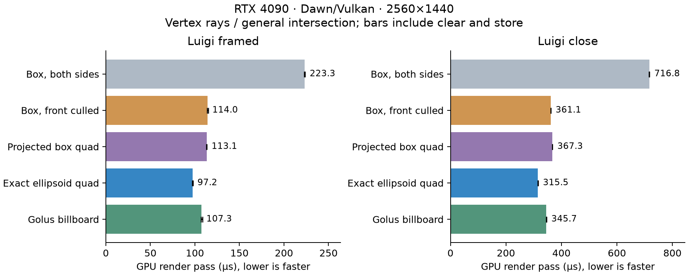
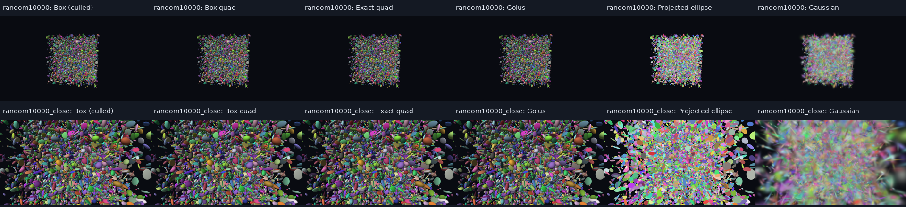
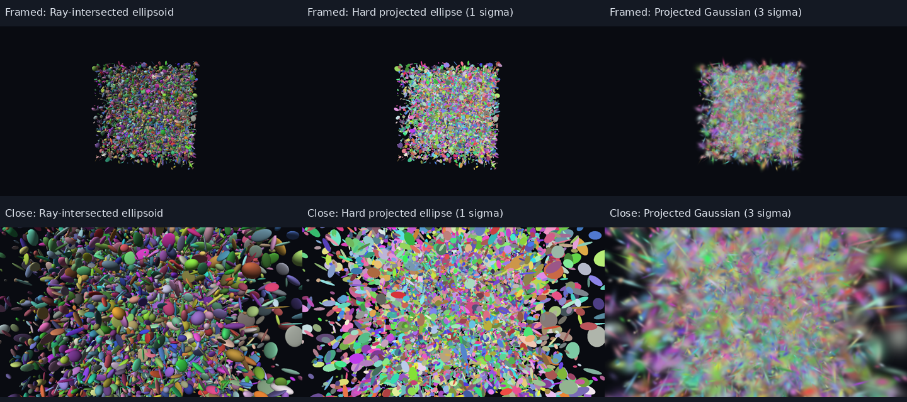

# Ellipsoid combinations: predictions and measurements

Measured 2026-10-18 on NVIDIA RTX 4090, driver 580.159.03, Dawn/Vulkan, Release build.

**Exact ellipsoid quads were the strongest choice for Luigi.** With vertex rays and the
unnormalized/general intersection fixed, they reduced GPU pass time by 9% versus Golus
and 13–15% versus the front-culled box at 2560×1440. Moving the ray transforms between
vertex and fragment stages was nearly neutral in those larger workloads, despite the
source-level arithmetic saving. This is a result for these shaders and scenes, not a GPU-wide ranking.

The predictions were written first in [PREDICTIONS.md](PREDICTIONS.md). Its SHA-256 was
saved before the first benchmark and matches the final file. No predictions were rewritten
after measurements. The four extra front-culled-box variants were also predicted before timing.

## Coverage comparison

GPU render-pass microseconds, median of three trial medians. Lower is faster.
All rows below use vertex ray transforms and the general, unnormalized intersection.
Depth format is Depth32Float for every benchmark variant; the interactive viewer uses Depth24Plus.

| Coverage | Luigi framed | Luigi close | Close batch wall time |
|---|---:|---:|---:|
| Box, both sides | 223.3 | 716.8 | 738.7 |
| Box, front faces culled | 114.0 | 361.1 | 372.2 |
| Projected eight-corner box quad | 113.1 | 367.3 | 377.0 |
| Exact ellipsoid quad | 97.2 | 315.5 | 321.9 |
| Golus sphere billboard | 107.3 | 345.7 | 357.6 |

The empty-pass baseline was about 3.3 µs at this resolution and is included, not subtracted.
Front-face culling almost halves the two-sided box cost on close Luigi without changing
its 36 vertex invocations. This shows why raw vertex/FLOP counts alone are insufficient.
The eight-corner quad is not a clear win over the culled box; exact ellipsoid bounds are tighter.



A copy of the chart and contact sheet is retained with the raw results. Regenerate them
from the benchmark output using the analysis script below.

## All exact combinations at 2560×1440

Same scenes and shaders, varying coverage, transform stage, and local-ray normalization.
Values are microseconds; small differences should not be read as decisive wins.

| Method | Luigi framed GPU | Luigi close GPU | Close batch wall |
|---|---:|---:|---:|
| `box_vertex_general` | 223.33 | 716.80 | 738.67 |
| `box_vertex_normalized` | 223.01 | 717.86 | 739.68 |
| `box_fragment_general` | 222.69 | 718.59 | 741.01 |
| `box_fragment_normalized` | 222.78 | 718.37 | 737.86 |
| `box_quad_vertex_general` | 113.12 | 367.33 | 376.99 |
| `box_quad_vertex_normalized` | 113.38 | 367.49 | 377.20 |
| `box_quad_fragment_general` | 113.38 | 368.77 | 379.47 |
| `box_quad_fragment_normalized` | 113.57 | 368.06 | 379.65 |
| `exact_quad_vertex_general` | 97.22 | 315.46 | 321.91 |
| `exact_quad_vertex_normalized` | 96.96 | 315.46 | 325.10 |
| `exact_quad_fragment_general` | 97.82 | 315.55 | 325.41 |
| `exact_quad_fragment_normalized` | 97.44 | 315.84 | 323.13 |
| `golus_vertex_general` | 107.26 | 345.66 | 357.62 |
| `golus_vertex_normalized` | 106.82 | 345.66 | 356.37 |
| `golus_fragment_general` | 107.36 | 346.34 | 359.67 |
| `golus_fragment_normalized` | 108.13 | 345.95 | 357.52 |
| `box_culled_vertex_general` | 113.95 | 361.06 | 372.25 |
| `box_culled_vertex_normalized` | 114.18 | 361.31 | 373.01 |
| `box_culled_fragment_general` | 114.08 | 361.57 | 371.05 |
| `box_culled_fragment_normalized` | 114.18 | 361.47 | 372.59 |

For exact quads on close Luigi, vertex/general measured 315.46 µs and fragment/general
315.55 µs. Vertex/normalized measured 315.46 µs. These do not establish an advantage for
moving transforms or normalizing the ray here. A lower source-level operation count did
not translate directly into a measurable improvement. Determining whether interpolation,
register pressure, raster/depth work, or compiler scheduling causes that requires profiling;
this experiment does not identify the bottleneck.

## Predictions versus observations

| Prediction | Observation |
|---|---|
| Vertex transforms win for large footprints | Not supported on close Luigi: essentially tied. Arithmetic saving alone was not predictive. |
| Golus competitive for spheres/tiny footprints | Supported broadly; small-pass differences are often too noisy for a firm ordering. |
| Tight exact bounds help anisotropic, larger workloads | Supported on Luigi at both resolutions; 1440p framed/close were 9% faster than Golus. |
| Eight-corner bounds usually lose to exact bounds | Supported on Luigi; tiny-grid cases are closer and can reverse. |
| Box has high geometry/duplicate-fragment cost | Supported strongly for two-sided boxes. Front culling removes most of the duplicate cost. |
| No confident normalization winner | Supported: only small or inconsistent changes in larger workloads. |
| Hard projected ellipse cheaper when fill-bound | Observed, but it produces a different image and does not write ellipsoid surface depth. |
| Gaussian costs more than hard ellipse | Observed: wider support, exp, blending, and no opaque depth writes. |
| Single-object pass overhead limits ranking | Supported: empty clear/store is a substantial fraction of the few-µs passes. |
| Exact variants should broadly agree | Supported for larger objects; tiny grid silhouettes expose precision differences. |
| Front-face culling helps the box | Supported: roughly halves close Luigi time. |

## Approximate/opacity controls

These are separate rendering behaviors, not equal-image alternatives to the exact methods.
The projected ellipse uses 1-sigma support, Gaussian 3-sigma support. Both use the same
local perspective covariance approximation. Neither writes surface depth. Gaussian draws
are unsorted and retain source order; these numbers exclude sorting and do not describe
a complete Gaussian-splatting renderer. The hard ellipse is drawn in source order too.

| Control | Luigi framed, 1440p | Luigi close, 1440p |
|---|---:|---:|
| Hard projected ellipse | 42.8 µs | 115.2 µs |
| Gaussian opacity | 255.5 µs | 751.3 µs |

## Image and depth validation

Every exact variant is compared with exact-quad/vertex/general in the same scene/camera.
RGB changes count pixels where any RGB channel differs by more than 5/255. Coverage is
depth < 1; depth changes count shared occupied pixels differing by more than 1e-5 in device
depth. This is tolerant comparison, not bit equality. Approximate controls have no depth
writes, so their raw depth-coverage metrics are not useful correctness comparisons.

- Single-object scenes: at most 15 changed RGB pixels or coverage pixels over a frame.
- Luigi: at most 348 changed RGB pixels, 15 coverage changes, and 53 shared-hit depth changes
  across the tested combinations/views. Largest shared-hit device-depth difference was
  0.0012325; this is not a guarantee of identical occlusion at primitive boundaries.
- Tiny sphere grid at 1440p: up to 1,007 coverage changes relative to 385,314 occupied
  reference pixels (0.26%).
- Tiny thin-ellipsoid grid: up to 806 coverage changes relative to 96,936 occupied reference
  pixels (0.83%), and 1,644 RGB changes (1.70% of occupied reference pixels; 0.045% of frame).
  These cases are a precision limitation of the tested ray/interpolation computations,
  not evidence that all variants are interchangeable at subpixel silhouettes.
- Representative close ellipsoids, grids, and Luigi images were inspected manually. The
  analytic proxies show the same intended geometry; the approximate controls visibly differ.

Representative images are retained in `results/2026-10-18/contact-sheet.png`. Source PPMs can be regenerated with the benchmark.
No camera-inside, orthographic, near-plane torture suite, or temporal sweep was performed.

## Measurement scope and reproducibility

20 exact variants + ellipse + Gaussian + empty pass, eight scenes, two resolutions,
three trials: **1,104 rows and 70,656 individual GPU timestamp samples**.
Scenes: sphere, anisotropic ellipsoid, close ellipsoid, off-axis ellipsoid, 4,096-sphere grid,
4,096-ellipsoid grid, Luigi framed, and Luigi close. Luigi contains 14,526 primitives.
Resolution: 1280×720 and 2560×1440. All exact methods use the same shading and depth states
except for the explicitly named box culling control. No additional frustum-culling prepass.

Each variant warms up with 16 passes, records 64 separately timestamped passes, then times
a separate batch of 64 uninstrumented passes. Batch wall time includes submit/wait overhead,
not command encoding. Timestamp measurements include render-pass clear/store. UI, wireframes,
presentation, asset loading, camera/scene uploads, pipeline creation, and readback are excluded.
Variant order is shuffled with a fixed seed per trial. Error bars span the three trial medians,
not confidence intervals; raw within-trial timing samples and p90 are in the CSV.

Dawn's default timestamp quantization produced 65.536-µs steps in the first sweep. That initial data is not used for the GPU rankings above; its old build directory has been removed. The final sweep explicitly disables native Dawn `timestamp_quantization`;
conversion to nanoseconds stays enabled. Source: `external/dawn/src/dawn/native/Toggles.cpp`.

The experiment viewer was paused during timing. The workstation was not GPU-exclusive:
Sunshine streaming was active (about 12% SM in a process snapshot), plus the desktop.
Background GPU utilization before the final sweep was 22%. Large Luigi trial medians
were stable, while some tiny cases fluctuated noticeably. Treat close small-case rankings
as inconclusive. No system processes were paused and no power/clock settings changed.

```sh
cmake --build build --target ellipsoid ellipsoid_benchmark -j 12
VK_DRIVER_FILES=/usr/share/vulkan/icd.d/nvidia_icd.json \
  ./build/ellipsoid_benchmark build/ellipsoid-benchmark
# With matplotlib and Pillow available:
python3 experiments/analyze_ellipsoid.py build/ellipsoid-benchmark
```

Raw final data and hardware metadata: [results/2026-10-18/](results/2026-10-18/).
[summary.csv](results/2026-10-18/summary.csv) contains every scene/method aggregate;
[results.csv](results/2026-10-18/results.csv) retains the individual timestamp samples.
The analysis script can also summarize that saved directory directly.

Timing method reference: [WebGPU Fundamentals](https://webgpufundamentals.org/webgpu/lessons/webgpu-timing.html).
Golus reference: [complete shader](https://gist.github.com/bgolus/1188cd89968b977d5c468bf7bbb3250b),
with a local copy in `references/CompleteSphereImpostor.shader`.

## Follow-up: 10,000 random Gaussians

The scene changes; the shaders, 20 exact combinations, two approximate controls, and
empty-pass baseline stay the same. Predictions were saved before timing in
[PREDICTIONS_RANDOM.md](PREDICTIONS_RANDOM.md). Original results above are preserved.

Seed 10000. Centers are uniform in [-2,2]^3; each semi-axis is independently log-uniform
in [0.01,0.12]. Rotations are uniform, sampled by normalizing four independent standard
normal values. RGB is uniform in [0.2,0.95] and opacity in [0.1,0.9]. Both cameras use
exactly the same 10,000 primitives, centered at the origin, with distances 7.5 and 3.8.
This creates spatial overlap and random anisotropy rather than a planar grid.

GPU pass times in microseconds; each cell is the median of three trial medians.
The table fixes vertex transforms and general intersections, as in the earlier comparison.

| Proxy | Framed 720p | Close 720p | Framed 1440p | Close 1440p |
|---|---:|---:|---:|---:|
| Box, both sides | 42.53 | 75.94 | 74.37 | 230.30 |
| Box, front faces culled | 26.11 | 47.36 | 42.53 | 118.05 |
| Projected box quad | 17.73 | 40.38 | 39.71 | 123.94 |
| Exact ellipsoid quad | 15.04 | 35.20 | 35.65 | 105.63 |
| Golus sphere billboard | 18.78 | 42.85 | 42.69 | 130.08 |

At close 1440p, exact quads reduced GPU time by 18.8% versus Golus, 10.5% versus culled
boxes, and 54.1% versus two-sided boxes. Their uninstrumented batch wall time was 109.23 µs,
versus 134.55 µs for Golus. This supports the prediction that tighter bounds help this
anisotropic overlapping scene. It does not establish the same ranking for every random distribution.

Exact-quad/fragment/general measured 104.83 µs, vertex/general 105.63 µs, and
vertex/normalized 104.58 µs at close 1440p. There is again no strong transform-stage or
normalization advantage. The hard projected ellipse measured 40.90 µs and the unsorted
3-sigma Gaussian opacity control 240.26 µs; their rendering behavior remains different.

Image checks against the exact-quad/vertex/general reference found at most 2,537 RGB
changes above 5/255 (0.069% of a 1440p frame), 619 coverage changes, and 1,548 shared-hit
depth changes above 1e-5 over all exact combinations/views. The maximum shared-hit
device-depth discrepancy was 0.0036657. These are precision/occlusion limitations of the
comparison, not proof of identical depth. Representative images were manually inspected.



The sweep contains 276 rows and 17,664 GPU samples: 23 methods × two cameras × two
resolutions × three trials × 64 samples. Same RTX 4090/Dawn/Vulkan setup and timing scope
as above, with timestamp quantization disabled and the experiment viewer paused.
Background GPU utilization was recorded in `gpu-before.csv`; the workstation was not exclusive.

```sh
cmake --build build --target ellipsoid_benchmark -j 12
VK_DRIVER_FILES=/usr/share/vulkan/icd.d/nvidia_icd.json \
  ./build/ellipsoid_benchmark build/ellipsoid-random10000 random10000
python3 experiments/analyze_ellipsoid.py build/ellipsoid-random10000 random10000 random10000_close
```

The optional second argument after the output directory filters scene names by prefix.
With no filter, the benchmark now includes these random scenes alongside the original scenes.
[Raw data, summaries, and images](results/2026-10-18/random10000/).

## Explicit projected-splat rerun: 10,000 random Gaussians

Reran the same seeded random scene, both cameras and resolutions, three shuffled trials,
with the existing exact combinations and controls. This table highlights the two requested
projected splats; the original results above are preserved. Median GPU pass microseconds:

| Resolution / view | Ray-intersected ellipsoid | Hard projected ellipse | Gaussian projected splat |
|---|---:|---:|---:|
| 720p framed | 15.07 | 11.74 | 30.14 |
| 720p close | 34.34 | 18.11 | 73.57 |
| 1440p framed | 36.13 | 23.14 | 71.58 |
| 1440p close | 104.80 | 41.98 | 240.26 |

Both splats build a four-vertex quad from the local perspective covariance approximation
and evaluate q = delta^T Sigma_screen^-1 delta per fragment. The hard ellipse retains q≤1
and outputs flat color. The Gaussian retains q≤9 and uses alpha = opacity × exp(-q/2), with
premultiplied-alpha blending. Neither control writes surface depth. Both retain source draw
order; there is no depth sorting. They have different images and visibility behavior.

The written quadratic costs seven multiplies and two additions before the cutoff test.
The Gaussian adds the exponential, opacity/color multiplication and blending, and expands
the nominal support area by 9× before screen clipping. This accounts for important differences
beyond the common covariance setup; this experiment does not isolate each cost separately.
The hard ellipse was fastest in these views, while the Gaussian was about 5.7× its GPU time
in the close 1440p view. The Gaussian opacity path is still an unsorted rendering control,
not a complete 3DGS pipeline.

The close 1440p hard ellipse trial medians ranged 39.81–42.69 µs and Gaussian 239.71–240.35 µs.
Framed 1440p ellipse timings were noisier (18.21–25.18 µs). Separate batch wall medians for
close 1440p were 44.57 µs (ellipse), 248.33 µs (Gaussian), and 108.21 µs (exact ellipsoid).
Background streaming remained active; the experiment viewer was paused and then resumed.

The rendered framed and close images were inspected. Expected differences are visible:
flat ellipse colors and source-order overlap versus smooth, blended Gaussian footprints.
Pixel equality with the shaded exact ellipsoid is not expected.



[Raw rerun and focused summary](results/2026-10-18/random10000-splats/).
Reproduce with the earlier command, replacing the output directory with
`build/ellipsoid-random10000-splats`. Shader and benchmark code are unchanged.
